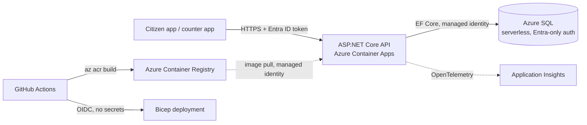

# Appointments API on Azure

[](https://github.com/coldworld22/appointments-api/actions/workflows/ci.yml)


[](LICENSE)

A booking backend for government service centres: citizens reserve a time slot for a service (ID renewal, vehicle registration, a permit review), counter staff check them in and close the visit, and administrators open each day's slots. It's modelled on the citizen-facing systems I've built for Saudi public-sector clients, rebuilt here on the Microsoft stack.

The interesting parts are the ones that break in production: two people taking the last seat at the same moment, time windows that have to be exact, data that citizens must never see across accounts, and an Azure deployment with no secrets in it.

## Features

- **No overbooking, even under a race.** Each slot carries a SQL Server `rowversion`. When several citizens book the last seat at once, exactly one save succeeds; the others are retried against fresh data and get `409 slot_full`. A `CHECK (Booked <= Capacity)` constraint backs this up in the database. An integration test fires 8 simultaneous bookings at a 1-seat slot and asserts exactly one wins.
- **Business rules in the domain model**, not the controllers: 30 minutes' minimum notice, a 30-day booking horizon, cancellation up to 2 hours before, check-in from 30 minutes before to 15 minutes after the start, one active booking per citizen per service. Missed appointments stop blocking new bookings once their check-in window closes.
- **Microsoft Entra ID sign-in** with app roles (`Staff`, `Admin`) read from the `roles` claim, enforced with authorization policies per endpoint.
- **Data isolation:** citizens only ever see their own appointments. Anyone else's ID answers `404`, so IDs can't be probed.
- **RFC 9457 problem responses** with a stable `code` (`slot_full`, `too_late_to_cancel`, …) so clients branch on codes, not message text.
- **Per-user rate limit** on booking with ASP.NET Core's built-in rate limiter.
- **Versioned SQL migrations** (DbUp) embedded in the assembly; EF Core 10 maps onto that schema. The tests run against the same scripts, so model and schema can't drift silently.
- **Health probes** (`/health/live`, `/health/ready` with a database check), **OpenAPI** at `/openapi/v1.json`, and **OpenTelemetry → Application Insights** in Azure.
- **Testable time:** everything reads the clock through .NET's `TimeProvider`, so tests move time to the exact edge of each window.

## Architecture



```
src/Appointments.Api
├── Domain/          Slot, Appointment, BookingRules — the rules, no framework code
├── Data/            EF Core DbContext, DbUp migrator, SQL scripts (Scripts/, Demo/)
├── Features/        Minimal API endpoints: catalog, appointments, counter queue, admin
├── Auth/            Entra JWT setup, roles and policies, dev sign-in handler
└── Infrastructure/  problem-details error mapping
tests/Appointments.Tests
├── BookingRulesTests.cs     domain rules, every time-window edge
└── AppointmentApiTests.cs   HTTP → EF Core → SQL Server in Docker (Testcontainers)
infra/main.bicep             Container Apps, ACR, Azure SQL, identity, monitoring
```

## API

| Method | Path | Who | What |
|---|---|---|---|
| GET | `/branches`, `/services` | signed in | Catalog |
| GET | `/branches/{id}/slots?serviceTypeId=&date=` | signed in | Open slots with free seats for a day |
| POST | `/appointments` | signed in | Book a slot `{ "slotId": 42 }` |
| GET | `/appointments/mine` | signed in | My appointments |
| GET | `/appointments/{id}` | owner, staff | One appointment |
| POST | `/appointments/{id}/cancel` | owner, admin | Cancel and free the seat |
| POST | `/appointments/{id}/check-in` | staff | Check in at the counter |
| POST | `/appointments/{id}/complete` | staff | Close the visit |
| GET | `/branches/{id}/queue?date=` | staff | The day's queue for a branch |
| POST | `/admin/slots` | admin | Open a day of slots (idempotent) |

Appointment life cycle: `Booked → CheckedIn → Completed`, or `Booked → Cancelled`. Anything else is `409 Conflict`.

## Run it locally

You need Docker.

```bash
docker compose up --build
```

The API listens on http://localhost:5080 in Development mode, where sign-in is simulated with two headers: `X-Dev-User: citizen-1` and `X-Dev-Roles: Staff,Admin`. That mode refuses to start in any other environment. [`Appointments.Api.http`](src/Appointments.Api/Appointments.Api.http) has a walk-through: open slots, find one, book it, see the counter queue.

To run from source instead: start SQL Server (`docker compose up sql`) and `dotnet run --project src/Appointments.Api`.

## Tests

```bash
dotnet test
```

Needs the .NET 10 SDK and Docker. The integration tests start SQL Server 2022 in a container, create the schema with the production migration scripts, and drive the real API in memory with `WebApplicationFactory`.

## Deploy to Azure

Everything is in [`infra/main.bicep`](infra/main.bicep): Container Apps environment and app, Container Registry, Azure SQL (serverless, Entra-only), a user-assigned managed identity, Log Analytics and Application Insights.

One-time setup:

1. **API app registration** in Entra ID: expose an API, add app roles `Staff` and `Admin`, and set `accessTokenAcceptedVersion` to `2` in the manifest. Its client ID is the token audience.
2. **Deployment identity** for GitHub Actions: an app registration with a federated credential for this repository's `production` environment, and Owner (or Contributor + User Access Administrator) on the resource group. Owner is needed because the template assigns the AcrPull role.
3. **Repository variables** (Settings → Variables): `AZURE_CLIENT_ID`, `AZURE_TENANT_ID`, `AZURE_SUBSCRIPTION_ID`, `AZURE_RESOURCE_GROUP`, `API_AUDIENCE`.

After that, every green CI run on `main` triggers [`deploy.yml`](.github/workflows/deploy.yml): Bicep deployment → `az acr build` → Container App rollout → smoke test on `/health/ready`. No credentials are stored anywhere: GitHub signs in with OIDC, the app reaches SQL and ACR with its managed identity, and SQL has password logins switched off.

To deploy by hand: `az deployment group create -g <rg> -f infra/main.bicep -p authAudience=<api-client-id>`.

## Production notes

Choices made for a demo that I'd change for a real service:

- **Database admin.** The app's identity is the SQL Entra admin so DbUp can migrate at startup. In production I'd make an Entra group the admin, run migrations from the pipeline, and grant the app only `db_datareader` and `db_datawriter`.
- **Network.** SQL allows Azure services through its firewall. A production setup would use a VNet-integrated Container Apps environment with a private endpoint for SQL and public access disabled.
- **Citizen identity.** Citizens would sign in through Entra External ID (or a national identity provider such as Nafath behind it), with staff in the workforce tenant; the API would then accept both issuers.
- **No-shows.** Missed bookings are recognised by time when checking for an active booking. A scheduled job could also mark them `NoShow` for reporting.

## License

MIT
